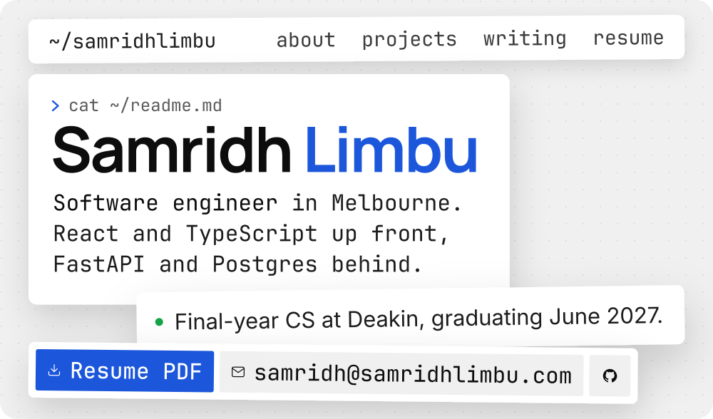
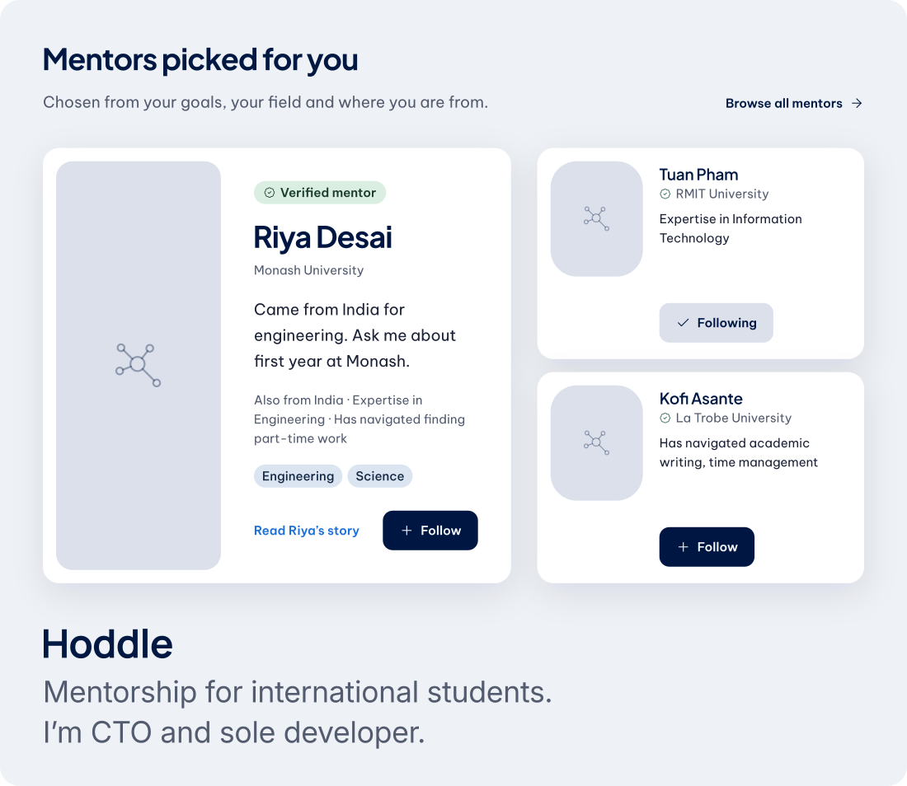
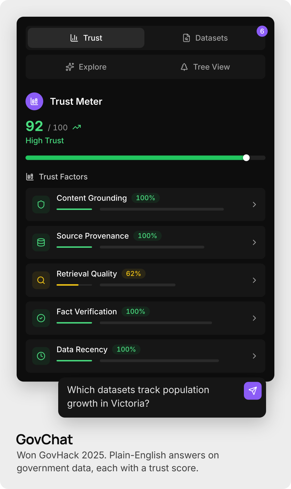
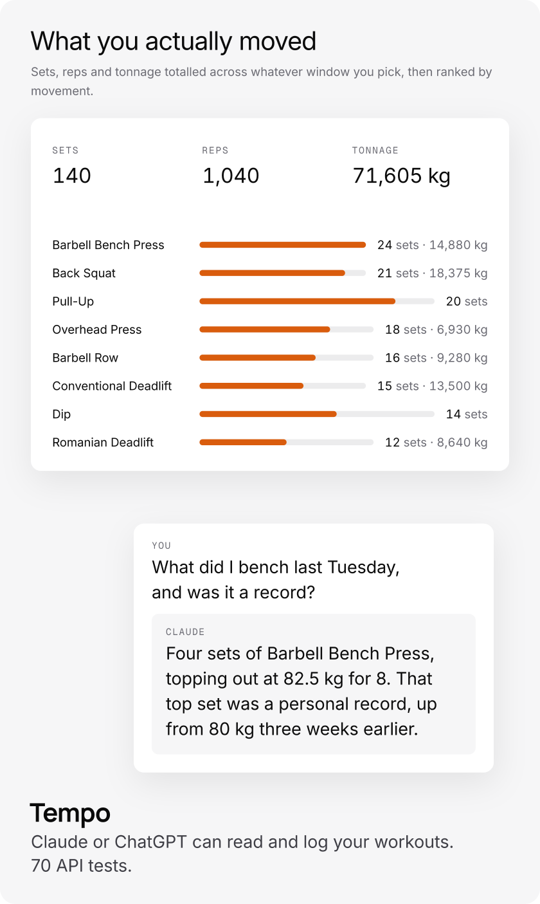
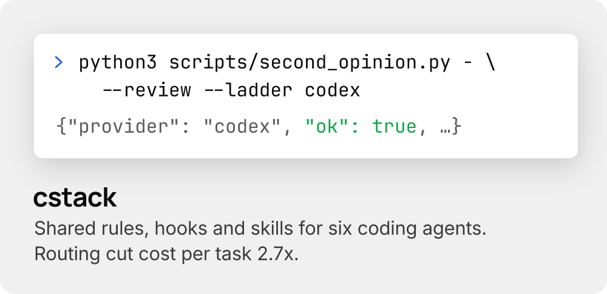

<picture>
  <source media="(prefers-color-scheme: dark)" srcset="./assets/banner-dark.svg">
  
</picture>

**open to** &nbsp; Summer 2026–27 software engineering internships and graduate roles from mid-2027, in Melbourne.

**now** &nbsp; Contract software engineer at a US health-tech startup, where I cut search latency from seconds to under 200&nbsp;ms. Also CTO of [Hoddle](https://hoddle.org) and president of [DSEC](https://dsec.club).

**links** &nbsp; [resume](https://samridhlimbu.com/resume) · [samridh@samridhlimbu.com](mailto:samridh@samridhlimbu.com) · [samridhlimbu.com](https://samridhlimbu.com)

 

<a href="https://hoddle.org"><picture><source media="(prefers-color-scheme: dark)" srcset="./assets/hoddle-dark.svg"></picture></a>

<a href="https://govchat-desc.vercel.app"><picture><source media="(prefers-color-scheme: dark)" srcset="./assets/govchat-dark.svg"></picture></a>
<a href="https://tempo.clupai.com"><picture><source media="(prefers-color-scheme: dark)" srcset="./assets/tempo-dark.svg"></picture></a>

<a href="https://github.com/Clupai8o0/cstack"><picture><source media="(prefers-color-scheme: dark)" srcset="./assets/cstack-dark.svg"></picture></a>

